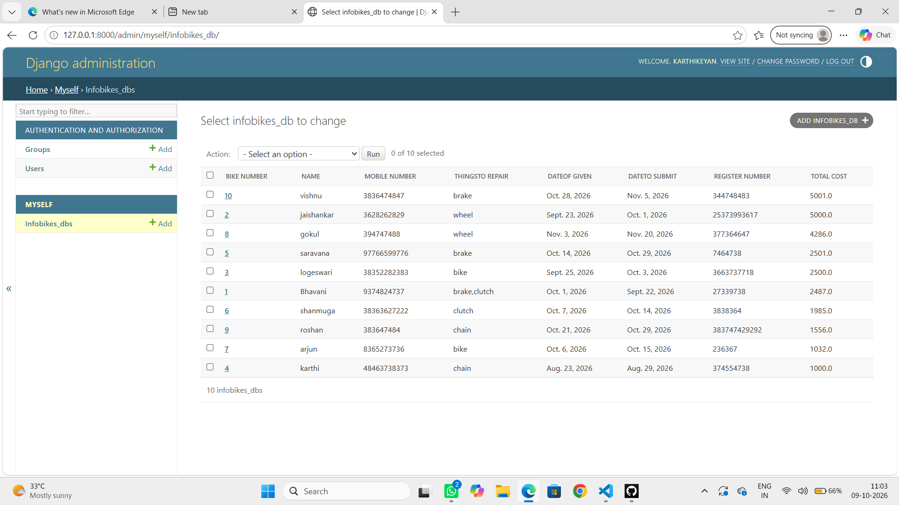

# Ex02 Django ORM Web Application
## Date: 09.10.2026

## AIM
To develop a Django Application to store and retrieve data from a Vehicle Service Database platform using Object Relational Mapping(ORM).


## DESIGN STEPS

### STEP 1:
Clone the problem from GitHub

### STEP 2:
Create a new app in Django project

### STEP 3:
Enter the code for admin.py and models.py

### STEP 4:
Detect changes and create migration files that describe how to modify the database schema

### STEP 5:
Execute the migration files and update the database schema to match your Django models

### STEP 6:
Create a superuser with full access rights to all models and data through the admin interface.

### STEP 7:
Apply the migration files of the created app to the database

### STEP 8:
Execute Django admin using localhost and create details for 10 entries

## PROGRAM
```
modrld.py
from django.db import models
from django.contrib import admin
class Infobikes_DB(models.Model):
    Bike_number=models.IntegerField()
    Name=models.CharField(max_length=10)
    Mobile_Number=models.IntegerField()
    Thingsto_repair=models.CharField(max_length=30)
    dateof_given=models.DateField()
    dateto_submit=models.DateField()
    register_number=models.IntegerField()
    total_cost=models.FloatField(primary_key=True)
class Infobikes_DBAdmin(admin.ModelAdmin):
    list_display=["Bike_number","Name","Mobile_Number","Thingsto_repair","dateof_given","dateto_submit","register_number","total_cost"]

 admin.py
from django.contrib import admin
from .models import Infobikes_DB,Infobikes_DBAdmin
admin.site.register(Infobikes_DB,Infobikes_DBAdmin)


```


## OUTPUT



## RESULT
Thus the program for creating Online Food Delivery Database using ORM hass been executed successfully
